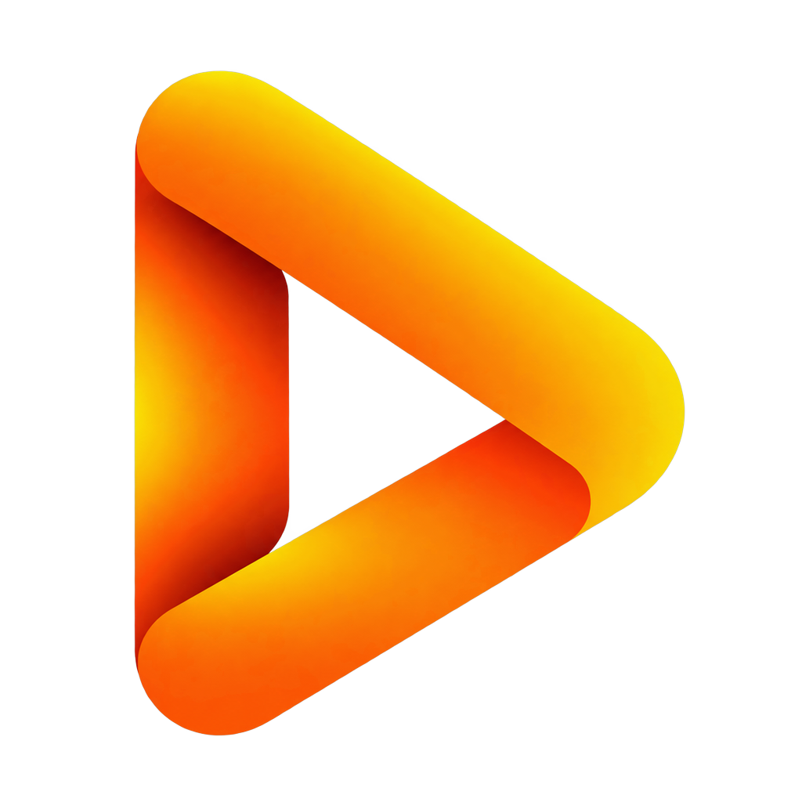

<p align="center">
  
</p>

<h1 align="center">afterAi</h1>

<p align="center">
  <strong>Smart AI Motion Graphics Studio | استوديو الموشن جرافيك الذكي</strong>
</p>

<p align="center">
  <a href="https://github.com/alabereche/afterAi/releases"></a>
  <a href="https://www.remotion.dev/"></a>
  <a href="https://react.dev/"></a>
  <a href="https://www.typescriptlang.org/"></a>
  <a href="https://www.electronjs.org/"></a>
  <a href="LICENSE"></a>
</p>

---

## Overview | نظرة عامة

**afterAi** is an open-source, agentic desktop studio that transforms natural language prompts into programmatic motion graphics and interactive video animations powered by [Remotion](https://www.remotion.dev/) and autonomous AI coding agents.

Instead of treating motion design as a black-box video generation render, **afterAi** crafts code-driven, fully editable React compositions with a real-time player, on-canvas free transform gizmo, collision-free multi-track timeline, and full bilingual interface support (العربية / English).

---

## Download | التحميل المباشر

Download the latest standalone installer or portable build for Windows:

* **[Download afterAi Setup (.exe)](https://github.com/alabereche/afterAi/releases)**

---

## Key Features | المميزات الأساسية

* **Dual AI Agent Workflow**:
  * **Google Antigravity (`agy` CLI)**: Free, fully autonomous local agent mode that plans, executes, and validates Remotion scene code.
  * **Direct API Mode**: Cloud connectivity supporting Google AI Studio (Gemini 3.8 Flash, 3.5 Lite, 3.1 Pro), OpenRouter, DeepSeek, Anthropic, and custom OpenAI-compatible endpoints.

* **On-Canvas Free Transform Gizmo**:
  * Direct 8-point bounding box to translate (X/Y), scale, and rotate any scene layer directly on the video player viewport.
  * Zero-flicker 60fps live preview during active drags with smart magnetic centering guides and keyboard nudge controls.

* **Multi-Track NLE Timeline**:
  * Dedicated lanes for text layers, visual card layers, and audio clips.
  * Rhythm beat markers and shot lanes with automated collision avoidance and non-overlapping timing guards.
  * Precision trimming handles, magnetic playhead snapping, razor split tool, and full undo/redo (`Ctrl + Z`).

* **Bilingual UI (Full Arabic & English Support)**:
  * Seamless one-click localization toggle (العربية / English) with full bidirectional layout support (RTL / LTR).
  * Adaptive, responsive toolbar scaling that prevents button clipping on any screen resolution.

* **In-Place Text & Style Inspector**:
  * Edit typography, colors, and font sizes directly on screen with instant visual sync and persistence.

* **Integrated Audio & SFX**:
  * Voiceover recording with automatic speech pause analysis, procedural sound effects, and custom audio track uploads.

* **Pixel-Perfect Multimodal Frame Capture**:
  * High-fidelity GPU compositor snapshots directly attached to prompts for multimodal AI guidance.

---

## Architecture | معمارية المشروع

```
afterAi/
├── studio/                          # Electron + React + Vite Desktop Application
│   ├── electron/                    # Electron main process and lifecycle hooks
│   ├── server/                      # Local API server & autonomous agent controller
│   └── src/                         # Studio frontend UI
│       ├── components/              # PlayerView, Timeline, CanvasGizmo, ChatPanel, etc.
│       ├── i18n/                    # Localization dictionary (Arabic / English)
│       └── types/                   # TypeScript interfaces and scene data models
└── templates/
    └── motion-starter/              # Core Remotion motion graphics template
        ├── src/                     # Scene.tsx, Root.tsx, scene-data.json
        └── scripts/                 # Validation scripts & timeline timing tests
```

---

## Quick Start for Developers | تشغيل المشروع للمطورين

### Prerequisites
* **Node.js**: v18.0.0 or higher
* **npm**: v9.0.0 or higher
* **Git**: v2.30.0 or higher

### 1. Clone the Repository
```bash
git clone https://github.com/alabereche/afterAi.git
cd afterAi
```

### 2. Install Dependencies
```bash
# Install studio dependencies
cd studio
npm install

# Install Remotion starter template dependencies
cd ../templates/motion-starter
npm install
cd ../../
```

### 3. Run in Development Mode
```bash
cd studio
npm run electron:dev
```

Alternatively, to run the web UI and API server without Electron:
```bash
cd studio
npm run start
```
The studio will be accessible at `http://localhost:5173`.

### 4. Build Production Executable
```bash
cd studio
npm run build
npx electron-builder
```
The packaged executable and installer will be located in `studio/release/`.

---

## Keyboard Shortcuts | اختصارات لوحة المفاتيح

| Shortcut | Scope | Action |
| :--- | :--- | :--- |
| `Space` | Player | Play / Pause playback |
| `Ctrl + Z` | Timeline / Canvas | Undo last transform or timeline edit |
| `Ctrl + Shift + S` | Global | Capture frame snapshot to chat |
| `Ctrl + B` or `S` | Timeline | Split element at playhead |
| `Arrow Keys` | Canvas Gizmo | Fine nudge selected element by 1% |
| `Shift + Arrow` | Canvas Gizmo | Coarse nudge selected element by 5% |
| `Delete` / `Backspace` | Canvas Gizmo | Delete selected element |
| `Escape` | Global | Deselect element or close inspector |

---

## ملخص باللغة العربية (Arabic Summary)

**afterAi** هو استوديو مفتوح المصدر لإنشاء وتطوير الموشن جرافيك والرسوم المتحركة التفاعلية عبر الذكاء الاصطناعي وكود React البرمجي:
* **توليد الكود بالذكاء الاصطناعي**: يدعم Google Antigravity مجاناً أو مفاتيح API المباشرة (Gemini, DeepSeek, OpenAI) لكتابة وتعديل المشاهد البرمجية بدقة الإطار.
* **تحريك حر مباشر على الشاشة (Gizmo)**: سحب وتحجيم وتدوير العناصر مباشرة بالماوس فوق مشغل الفيديو مع محاذاة مغناطيسية ذكية.
* **تايم لاين متقدم متعدد المسارات**: تنظيم وقص ومزامنة النصوص والبطاقات والصوت دون تداخل، مع حماية المدد الزمنية للقطات.
* **واجهة ثنائية اللغة كاملة (عربي / إنجليزي)**: دعم كامل للاتجاهين (RTL / LTR) مع ضبط تلقائي متجاوب للأزرار على مختلف الشاشات.
* **محرر نصوص ومؤثرات صوتية**: تعديل مباشر للنصوص والألوان، ومكتبة مؤثرات صوتية مدمجة مع تسجيل ومزامنة التعليق الصوتي.

---

## Contributing | المساهمة في المشروع

Contributions are welcome! Please open an issue or submit a pull request for any bug fixes, improvements, or new features.

1. Fork the Project
2. Create your Feature Branch (`git checkout -b feature/AmazingFeature`)
3. Commit your Changes (`git commit -m 'feat: add amazing feature'`)
4. Push to the Branch (`git push origin feature/AmazingFeature`)
5. Open a Pull Request

---

## License | الترخيص

This project is licensed under the Apache License, Version 2.0 - see the [LICENSE](LICENSE) file for details. Remotion components are subject to the [Remotion License](https://www.remotion.dev/license).
